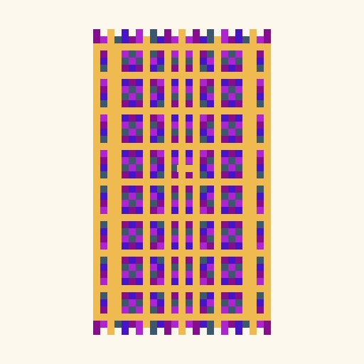
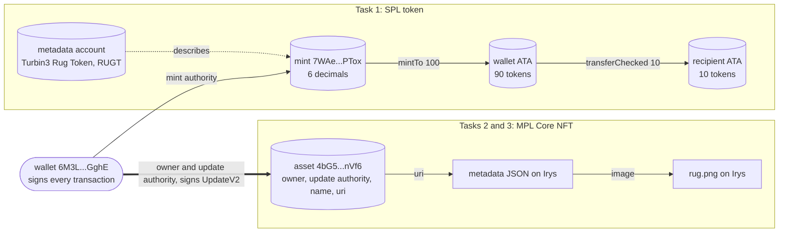

# spl-nft-q426

Turbin3 Builders Q4 2026, week 1 assignment. Scripts that mint and transfer an
SPL token, mint an NFT with Metaplex Core, and update the NFT as the update
authority. All transactions run on Solana devnet.

<p align="center">
  
</p>

## Assignment

1. Mint and transfer your own SPL token.
2. Mint an NFT using MPL Core.
3. Update the NFT name and metadata as the update authority.

All three tasks are complete. The section [Results](#results) lists each
transaction. The section [Proof on devnet](#proof-on-devnet) shows the test
output and the program logs. The extension tasks (transfer and burn the NFT)
are not part of this repo.

## How it works



The wallet signs every transaction. It is the mint authority of the token. It
is also the owner and the update authority of the asset.

- **Task 1:** the token balances are in associated token accounts (ATAs), not
  in the wallets. Each ATA belongs to one wallet and one mint.
- **Task 2:** a Core asset is one account. It holds the owner, the update
  authority, the name, and the URI of the metadata JSON.
- **Task 3:** one `UpdateV2` instruction writes a new name and a new URI into
  the asset account. Only the update authority can sign it.

## Results

The run was on 2026-11-05, from 16:54 to 16:58 UTC.

Wallet: [`6M3LySJ4D9y8PwwgeCMCs56MHAUa8ZJh3PYn5vmxGghE`](https://explorer.solana.com/address/6M3LySJ4D9y8PwwgeCMCs56MHAUa8ZJh3PYn5vmxGghE?cluster=devnet)

### Task 1: SPL token

| Item | Value |
|---|---|
| Mint | [`7WAetXWZ5vF5YqwVJGBbT3miXFWE6atVXyq9Ay9wPTox`](https://explorer.solana.com/address/7WAetXWZ5vF5YqwVJGBbT3miXFWE6atVXyq9Ay9wPTox?cluster=devnet) |
| Name / symbol / decimals | Turbin3 Rug Token / RUGT / 6 |
| Create mint | [`4znmrCXB...YQcNF`](https://explorer.solana.com/tx/4znmrCXBcoHPe6BrwBL3bBzSTo8kAwFjejMaoSCsupC2in5ogwEJ8JBmbT9wt3TojnmQmr9fD46JFm8wbADYQcNF?cluster=devnet) |
| Add metadata | [`5L9yMHZg...WzLsj`](https://explorer.solana.com/tx/5L9yMHZgztLJToA9wTAuCX42MPTTtKG1dfmZUNzbFQFrs4xXErVmJzAYRnUb3gHWNbJwBYd8yqnGLeK28uzWzLsj?cluster=devnet) |
| Mint 100 tokens | [`2sm1qqo6...MgrS9`](https://explorer.solana.com/tx/2sm1qqo6MAdTED84mxJiT9vTu8bGZeBTMk8KibfH6T2mAo2vmQmaZYPsKztc8TbozrkdXseZbSkTYyc4g7EMgrS9?cluster=devnet) |
| Transfer 10 tokens | [`6ytqupXv...nFMRf`](https://explorer.solana.com/tx/6ytqupXvLYa1LYWMaj1TZKH6NwSytjyn917bCMS5wbBTaZjSaaoJkigBYn1hTHwNcYqthTt2dbBT64myiQnFMRf?cluster=devnet) |
| Wallet ATA | [`HXRJrRBCzkYnD8jBAM3nAjGPctAFcSECZF5EAMdvVb75`](https://explorer.solana.com/address/HXRJrRBCzkYnD8jBAM3nAjGPctAFcSECZF5EAMdvVb75?cluster=devnet) |
| Recipient wallet | [`AEyXeEqQzru9rYhJ9k7QekMAMnEpdtnC4yAmHaUFZQQA`](https://explorer.solana.com/address/AEyXeEqQzru9rYhJ9k7QekMAMnEpdtnC4yAmHaUFZQQA?cluster=devnet) |
| Recipient ATA | [`7HE6yVtuiY27PQso3bwmykP3nNqCFbpJ2iqk4WYRxkwR`](https://explorer.solana.com/address/7HE6yVtuiY27PQso3bwmykP3nNqCFbpJ2iqk4WYRxkwR?cluster=devnet) |

After the transfer, the wallet holds 90 tokens and the recipient holds 10
tokens.

### Task 2: NFT mint

| Item | Value |
|---|---|
| Asset | [`4bG5Lk9yXB7nBDS5bomL29YvivGwDxnSE7CDxU5pnVf6`](https://explorer.solana.com/address/4bG5Lk9yXB7nBDS5bomL29YvivGwDxnSE7CDxU5pnVf6?cluster=devnet) |
| Name at mint | Turbin3 Rug |
| Image | [`3KMiNUfa...8DVeZ`](https://gateway.irys.xyz/3KMiNUfasFQShFBYHMscQ68hnZbC7JeShm5cYda8DVeZ) |
| Metadata at mint | [`F4nATic5...UWDu`](https://gateway.irys.xyz/F4nATic5Zc2wiaTnZqLpc9gas1opnhujVrybeCZuUWDu) |
| Mint (`CreateV2`) | [`VhGEiYen...WtRXQ6`](https://explorer.solana.com/tx/VhGEiYenyiQGxs9NsrFveYoVrDbL5B8kQGXzkuFH8kcdbp72W5LkVyvGXqLdXyGZVzLa4m4AUFABk2f41WtRXQ6?cluster=devnet) |

### Task 3: NFT update

| Item | Value |
|---|---|
| New name | Turbin3 Rug v2 |
| New metadata | [`Fo9N47GY...9S8Tx`](https://gateway.irys.xyz/Fo9N47GYUvG7eUwoKqFZhzERoKsCaGF5NBM7TUQ9S8Tx) |
| Update (`UpdateV2`) | [`4hccwUuq...RU1Ho`](https://explorer.solana.com/tx/4hccwUuqGd2pS2UphZ8feYWeyavcrJQNF2XqT98dRnuvMtMDbU9qrjh5R2KaS1b8DjUoTMHrtxZHBjgc2mhRU1Ho?cluster=devnet) |

The wallet is the owner and the update authority of the asset. It signed the
update.

**Note on the Irys links.** Irys deletes devnet uploads after about 60 days.
The image and the two JSON links can stop working in January 2027. The asset,
its name, and its URI stay on devnet. The Q3 run shows this: its Irys links
from 2026-09-04 returned HTTP 404 on 2026-11-06.

## Proof on devnet

### Test output

`npm test` on 2026-11-06, with Node 25.2.1:

```
▶ Task 1: SPL token
  ✔ the mint has 6 decimals and the wallet is the mint authority
  ✔ the token metadata has the name and the symbol
  ✔ the wallet ATA holds 90 tokens after the mint and the transfer
  ✔ the recipient ATA holds the 10 transferred tokens
✔ Task 1: SPL token
▶ Task 2 and 3: MPL Core NFT
  ✔ the NFT asset exists and the wallet owns it
  ✔ the wallet is the update authority
  ✔ the update changed the name and the metadata URI
  ✔ the new metadata JSON is online and matches the asset
✔ Task 2 and 3: MPL Core NFT
ℹ tests 8
ℹ suites 2
ℹ pass 8
ℹ fail 0
```

### The update transaction

`solana confirm -v 4hccwUuq...RU1Ho -ud` (excerpt):

```
Account 0: srw- 6M3LySJ4D9y8PwwgeCMCs56MHAUa8ZJh3PYn5vmxGghE (fee payer)
Account 1: -rw- 4bG5Lk9yXB7nBDS5bomL29YvivGwDxnSE7CDxU5pnVf6
Account 2: -r-x CoREENxT6tW1HoK8ypY1SxRMZTcVPm7R94rH4PZNhX7d
Status: Ok
Log Messages:
  Program CoREENxT6tW1HoK8ypY1SxRMZTcVPm7R94rH4PZNhX7d invoke [1]
  Program log: Instruction: UpdateV2
  Program log: programs/mpl-core/src/state/asset.rs:265:Approve
  Program 11111111111111111111111111111111 invoke [2]
  Program 11111111111111111111111111111111 success
  Program CoREENxT6tW1HoK8ypY1SxRMZTcVPm7R94rH4PZNhX7d consumed 7781 of 200000 compute units
  Program CoREENxT6tW1HoK8ypY1SxRMZTcVPm7R94rH4PZNhX7d success
Finalized
```

The wallet is the only signer. The MPL Core program approves the update and
writes the new name and URI. The System Program call adds rent for the longer
name: the asset balance goes from 0.00293764 to 0.00295288 SOL.

### The mint account

`spl-token display 7WAetXWZ5vF5YqwVJGBbT3miXFWE6atVXyq9Ay9wPTox -ud`:

```
SPL Token Mint
  Address: 7WAetXWZ5vF5YqwVJGBbT3miXFWE6atVXyq9Ay9wPTox
  Program: TokenkegQfeZyiNwAJbNbGKPFXCWuBvf9Ss623VQ5DA
  Supply: 100000000
  Decimals: 6
  Mint authority: 6M3LySJ4D9y8PwwgeCMCs56MHAUa8ZJh3PYn5vmxGghE
  Freeze authority: 6M3LySJ4D9y8PwwgeCMCs56MHAUa8ZJh3PYn5vmxGghE
```

The supply is 100000000 base units, so 100 tokens with 6 decimals.

## What I learned

- **A token balance is not in the wallet.** It is in a token account. Each
  wallet has one associated token account (ATA) for each mint, at an address
  that comes from the wallet and the mint.
- **`transferChecked` is safer than `transfer`.** The caller also gives the
  mint and the decimals. The Token Program rejects the transfer if they do not
  match the mint.
- **An MPL Core asset is one account.** The Token Metadata standard uses a
  mint, a token account, a metadata account, and a master edition for one NFT.
  A Core asset keeps the owner, the update authority, the name, and the URI in
  one account. This asset uses about 0.003 SOL of rent.
- **The owner and the update authority are two roles.** The owner can transfer
  the asset. The update authority can change the name and the URI. Here one
  wallet has both roles.
- **A read after a send needs the same commitment.** See `error.md`. With no
  commitment, the confirm can accept `processed` while the read uses
  `finalized`. All Umi instances now use `confirmed`.
- **Devnet storage is not permanent.** Irys deletes devnet uploads after about
  60 days. On mainnet, Irys stores the files on Arweave.

## Setup

### 1. Wallet

The scripts read the keypair from `WALLET_PATH`. The default is
`~/.config/solana/id.json`, the Solana CLI wallet. No keypair file is in the
repo.

```bash
# Optional: use another keypair file (a JSON array of 64 numbers).
export WALLET_PATH=~/path/to/devnet-wallet.json

# The wallet needs devnet SOL. The run used about 0.021 SOL.
solana airdrop 2 <your wallet address> -ud
```

### 2. Dependencies

You need Node 20.18 or later, because `@solana/kit` requires it. The run used
Node 25.2.1 and npm 11.6.2.

```bash
npm ci
```

### 3. Optional: custom RPC

The scripts read `SOLANA_RPC_URL` and `SOLANA_WS_URL`. The default is
`https://api.devnet.solana.com` and `wss://api.devnet.solana.com`.

## Scripts

Each script logs a value. Write that value in `src/addresses.ts`. The next
scripts and the tests read it from there.

`spl_init.ts` and `nft_mint.ts` stop if their value is already in
`src/addresses.ts`. This prevents a second mint or a second asset by accident.
Set `FORCE=1` to create a new one.

### Run all the steps again with your wallet

`src/addresses.ts` holds the values of my run. To start from zero:

1. Set `WALLET` to the address of your wallet.
2. Set `MINT`, `IMAGE_URI`, `METADATA_URI`, `ASSET`, and `NEW_METADATA_URI` to `""`.
3. Optional: set `RECIPIENT` to another address.
4. Run the scripts in the order of the two tables below.
5. After each script, write the logged value in `src/addresses.ts`.
6. Run `npm test`.

### SPL token

The scripts use **@solana/kit** and **@solana-program/token** for the
transactions, and **mpl-token-metadata** through Umi for the name and the
symbol.

| Command | What it does | Value to write in `src/addresses.ts` |
|---|---|---|
| `npm run spl:init` | Creates a mint with 6 decimals. The wallet is the mint authority. | `MINT` |
| `npm run spl:metadata` | Attaches the name and the symbol to the mint | none |
| `npm run spl:mint` | Creates the wallet ATA and mints 100 tokens into it | none |
| `npm run spl:transfer` | Creates the ATA of `RECIPIENT` and sends 10 tokens to it | none |

### NFT

The scripts use **mpl-core** through Umi. Irys stores the image and the
metadata JSON.

| Command | What it does | Value to write in `src/addresses.ts` |
|---|---|---|
| `npm run nft:image` | Uploads `rug.png` to Irys | `IMAGE_URI` |
| `npm run nft:metadata` | Builds the metadata JSON and uploads it | `METADATA_URI` |
| `npm run nft:mint` | Mints the Core asset with that URI | `ASSET` |
| `npm run nft:update` | Uploads a new JSON, then changes the name and the URI of the asset | `NEW_METADATA_URI` |

## Tests

The tests read the devnet state and compare it to the expected result of the
scripts. They use the Node.js test runner, so no extra test library is needed.

```bash
npm test
```

The tests check:

- The mint has 6 decimals and the wallet is the mint authority.
- The token metadata has the name "Turbin3 Rug Token" and the symbol "RUGT".
- The wallet ATA holds 90 tokens and the recipient ATA holds 10 tokens.
- The wallet owns the NFT asset and is its update authority.
- The asset has the name "Turbin3 Rug v2" and the new metadata URI.
- The new metadata JSON is online, has the same name, and has the cohort
  "Q4 2026".

The last test fails after Irys deletes the devnet upload. If you run the
scripts with another wallet, change `WALLET` in `src/addresses.ts`.

## Project layout

```
src/
├── config.ts      RPC endpoints and the wallet loader
├── addresses.ts   the values that the run produced
├── spl/           SPL token scripts (Kit)
├── nft/           MPL Core NFT scripts (Umi)
└── tests/         devnet state tests
docs/x-thread.md   the X thread about this assignment
wiki/              the index and the log of each step
error.md           each error with its cause and its fix
```

The scripts come from my Q3 2026 version of the same assignment:
[nada-r/spl-nft-q326](https://github.com/nada-r/spl-nft-q326).
